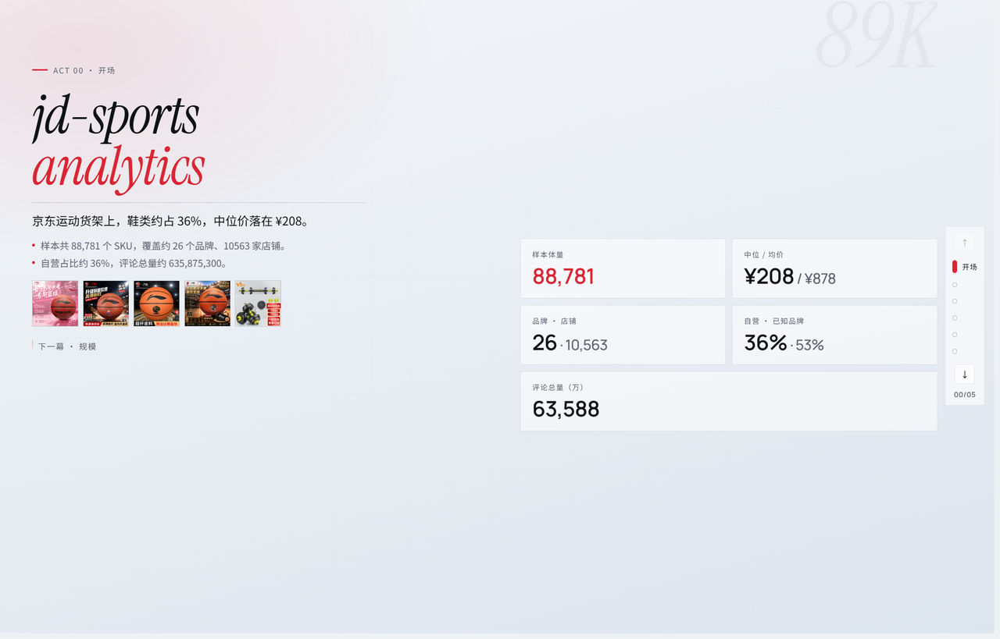
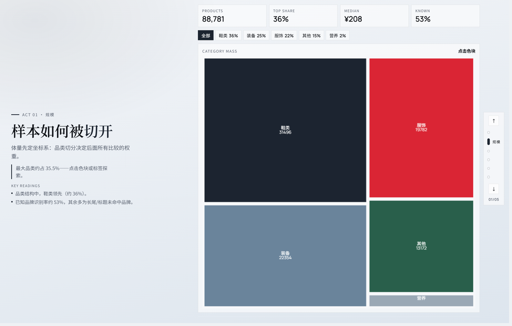
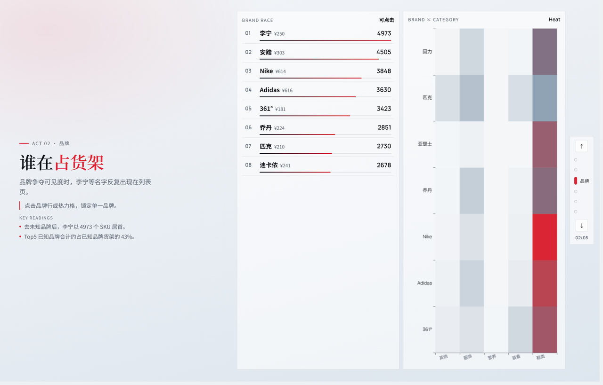
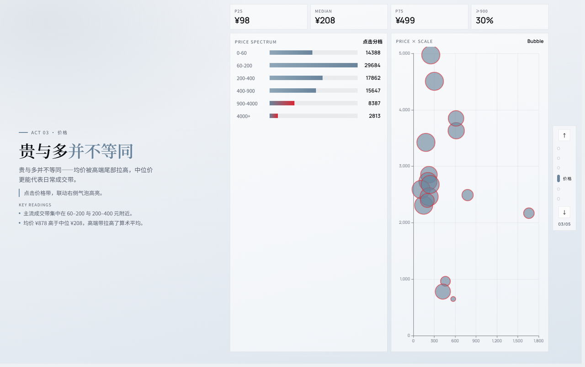
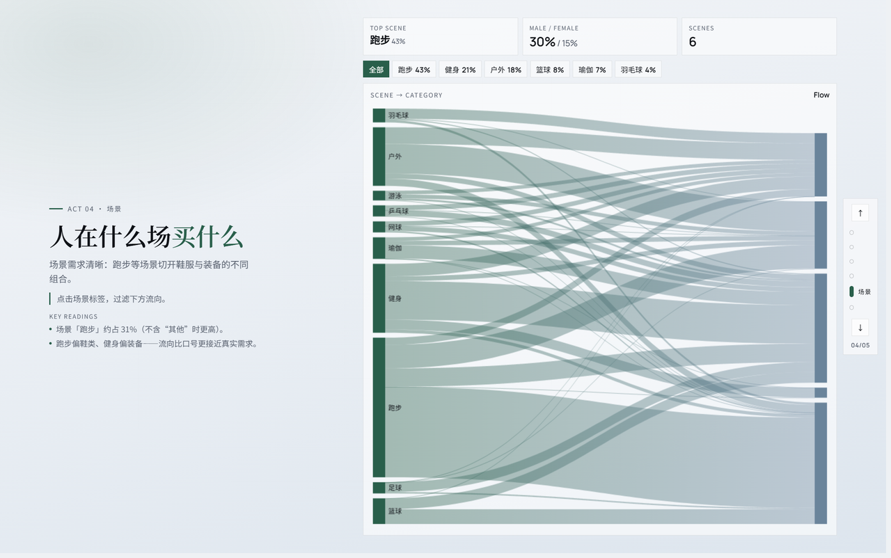
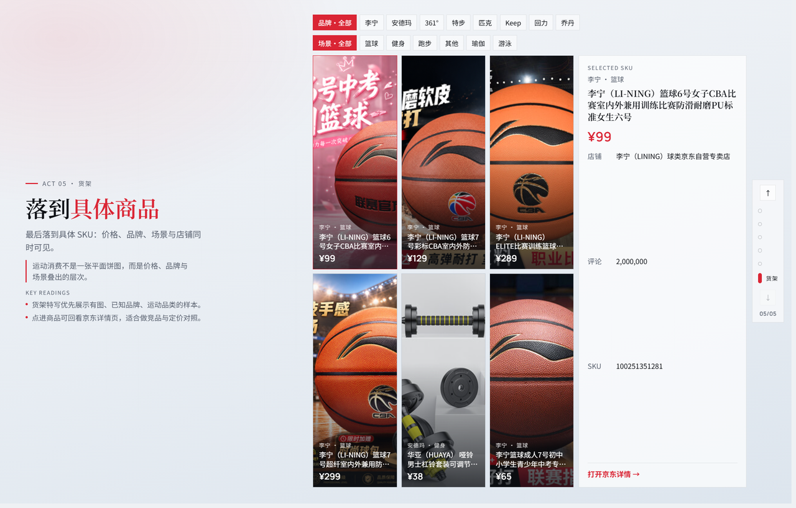

# jd-sports-analytics

**把京东运动货架，讲成一页一页的故事。**

从公开列表页爬取运动商品 → 清洗与 enrichment → 一屏一幕的 Web 数据叙事。不是堆表格的报表，而是可滚动的编辑向故事：规模、品牌、价格、场景，最后落到具体 SKU。

<p align="center">
  
</p>

<p align="center">
  <em>Act 00 · 开场 — 约 8.9 万 SKU，一眼看清体量、中位价与自营占比</em>
</p>

---

## 为什么是这个项目

| | |
|---|---|
| **数据故事，不是仪表盘堆砌** | 六幕叙事，每幕刚好一屏；侧栏 ↑↓ / 键盘切幕 |
| **真实货架切片** | 公开热卖页 `re.jd.com`，去重后控制在 10 万以内 |
| **边爬边用** | 爬虫与清洗可并行；一键导出 `story.json` 驱动前端 |
| **可复现流水线** | `config.yaml` 控词表 / 品牌 / 并发，Windows PowerShell 友好 |

当前样本量级（完整抓取后）：

- **SKU** ≈ 8.9 万（软上限 9 万）
- **品牌 / 店铺** 覆盖主流运动品牌与长尾店
- **维度** 品类 · 品牌 · 价格带 · 运动场景 · 性别倾向

---

## 故事预览

> 截图随 UI 更新。改前端后请按文末「更新 README 截图」重截，避免图文不一致。

### Act 01 · 规模 — 面积即话语权

<p align="center">
  
</p>

品类 Treemap：鞋类 / 装备 / 服饰如何切分货架；点击色块或标签锁定品类。

### Act 02 · 品牌 — 谁在占货架

<p align="center">
  
</p>

品牌赛道榜 + 品牌×品类热力：点击行或热力格锁定品牌。

### Act 03 · 价格 — 贵与多并不等同

<p align="center">
  
</p>

价格带光谱 + 均价×规模气泡：点选价格带联动高亮。

### Act 04 · 场景 — 人在什么场买什么

<p align="center">
  
</p>

场景 → 品类 Sankey：跑步、健身、户外如何流向鞋服与装备。

### Act 05 · 货架 — 落到具体商品

<p align="center">
  
</p>

代表 SKU 画廊：品牌 / 场景筛选，点卡片看详情并跳转京东。

---

## 快速开始（Windows PowerShell）

```powershell
Set-Location F:\commercial\Sport
python -m venv .venv
.\.venv\Scripts\Activate.ps1
pip install -r requirements.txt
```

### 1. 爬取

```powershell
python -m src.crawler.run_crawl
# 默认续爬；全新文件可加 --no-resume
```

### 2. 清洗 / 导出故事数据

```powershell
# 全量清洗（结束时会导出 story.json）
python -m src.processing.clean

# 或单独导出 Web 叙事数据
python -m src.analysis.export_story
```

边爬边处理：

```powershell
python -m src.processing.watch --until-idle
```

### 3. 打开故事页（主展示）

```powershell
Set-Location F:\commercial\Sport\web
npm install
npm run dev
```

浏览器打开 [http://127.0.0.1:5173](http://127.0.0.1:5173) —— 滚轮切幕，右侧进度条可跳转；支持 `↑↓` / 空格 / `1–6`。

### Streamlit 备用看板

```powershell
Set-Location F:\commercial\Sport
.\.venv\Scripts\Activate.ps1
streamlit run app\streamlit_app.py
```

---

## 项目结构

```
jd-sports-analytics/
├── config.yaml              # 词表、品牌、并发与延迟
├── docs/screenshots/        # README 截图（需与当前 UI 同步）
├── scripts/refresh_readme_screenshots.py
├── web/                     # Vite + React 六幕故事页 ★
├── app/streamlit_app.py     # Streamlit 明细看板
├── src/
│   ├── crawler/             # 多查询并发爬虫（re.jd.com）
│   ├── processing/          # clean / watch
│   └── analysis/            # metrics + export_story
└── data/
    ├── raw/                 # products_*.jsonl
    └── processed/           # parquet / aggregates / story 输入
```

---

## 技术栈

| 层 | 选型 |
|---|---|
| 爬取 | Python · httpx · BeautifulSoup · 多线程并发 |
| 处理 | pandas · parquet |
| 叙事前端 | Vite · React · TypeScript · ECharts · Framer Motion |
| 备用看板 | Streamlit |

前端设计要点：Instrument Serif / Manrope / Noto SC、分幕色彩节奏、一幕一屏（`100dvh` + scroll-snap）。

---

## 配置要点

见 [`config.yaml`](config.yaml)：

- `crawl.workers` — 查询并发（默认 8）
- `crawl.delay_*` — 页间间隔
- `crawl.max_unique` — 唯一 SKU 软上限（默认 90000）
- `search.extra_queries` / `brands` / `sport_facets` — 覆盖面

礼貌抓取：限并发 + 随机延迟；不做登录、验证码绕过或非公开接口。

---

## 更新 README 截图

UI 或数据变更后，请同步截图，避免 README 仍是旧版界面：

1. `npm run dev` 打开故事页（建议视口约 1440×900）
2. 逐幕截图，命名为 `act-00-open.png` … `act-05-shelf.png`，放到 `%TEMP%\cursor\screenshots\`
3. 运行裁剪脚本写入 `docs/screenshots/`：

```powershell
Set-Location F:\commercial\Sport
.\.venv\Scripts\Activate.ps1
pip install pillow numpy   # 若尚未安装
python scripts\refresh_readme_screenshots.py
```

4. 按需改 README 里的说明文字（SKU 量级、品类结论等）

---

## License / 使用说明

本项目仅用于学习与公开数据分析演示。请遵守目标站点服务条款与当地法律；自行控制请求频率。
