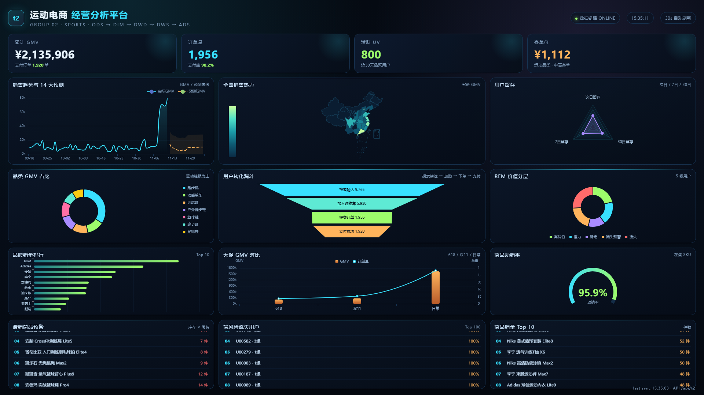

# t2 运动电商经营分析平台

> 洛阳理工学院 4.5 天实训 · 第 2 组（运动） · 13 ODS + 6 DIM + 10 DWD + 18 DWS + 16 ADS + 3 ML + 30 指标 + 20 API + 12 图表



## 这是什么

一套从贴源数据到经营大屏的完整电商分析平台：

```text
CSV → ODS → DIM → DWD → DWS → ADS → Flask API → ECharts 大屏
```

本地演示用 SQLite 一键跑通；同时交付 MySQL/Hive DDL、DataX 导入导出配置，可在实验虚拟机执行完整大数据链路。

## 一键运行

```powershell
.\pipeline.ps1
.venv\Scripts\python.exe -m flask --app flask_app.app run --port 5000
```

打开 <http://127.0.0.1:5000>。

## 核心数据

| 指标 | 值 |
|---|---:|
| ODS 行数 | 24,935 |
| GMV | 2,135,906.30 元 |
| 支付订单 | 1,920 |
| 客单价 | 1,112.45 元 |
| 支付率 | 98.16% |
| 复购率 | 50.69% |
| 退货率 | 8.8% |

## 目录

```text
sql/                  MySQL/Hive DDL
config/import|export  DataX 配置
scripts/              数据生成、数仓、ML、资产、校验
flask_app/            20 个 API
dashboard/            12 图表大屏
models/               ML 模型与评估
doc/                  过程文档、字段字典、指标体系、报告、PPT
data/ods_csv/         13 张 ODS CSV
```

## 3 个模型

- 销售预测：LinearRegression，R² 0.7782，MAPE 40.25%；
- 流失预测：LogisticRegression，F1 0.988；
- RFM：R/F/M 分位数打分 + 0.4/0.3/0.3 加权，五级分层。

## 文档索引

- [项目说明](doc/项目说明文档.md)
- [数仓设计](doc/数仓设计文档.md)
- [指标体系](doc/电商经营指标体系.md)
- [字段字典](doc/数仓字段字典.md)
- [API 文档](doc/API接口文档.md)
- [数据质量](doc/数据质量报告.md)
- [交叉验证](doc/交叉验证报告.md)
- [全链路复查](doc/全链路复查报告.md)

## 团队协作（按天重建 Gitee）

- [每日提交顺序：组长 → Coder A → Coder B](doc/每日提交顺序_组长A_B.md)
- [三人分工与每日提交计划](doc/三人分工与每日提交计划.md)
- [团队 AI 话术与每日执行指令](doc/团队AI话术与每日执行指令.md)

团队下载：

```powershell
git clone https://github.com/zhk0567/jd-sports-analytics.git
cd jd-sports-analytics
git pull
```

GitHub 只保存完整内容和协作文档；Gitee 的正式按天提交仓库是公开仓库 `t2_ecommerce`。本组固定 3 人，按照手册蓝色“3人”标签执行，不设 Coder C。

## 原始爬虫（保留）

`src/crawler` 与 `web/` 保留了京东运动货架爬虫与六幕叙事页；真实 8.9 万 SKU 切片见 `doc/真实货架洞察.md`，作为运动品类业务背景与数据校验，不参与可复现 ODS 明细生成。
